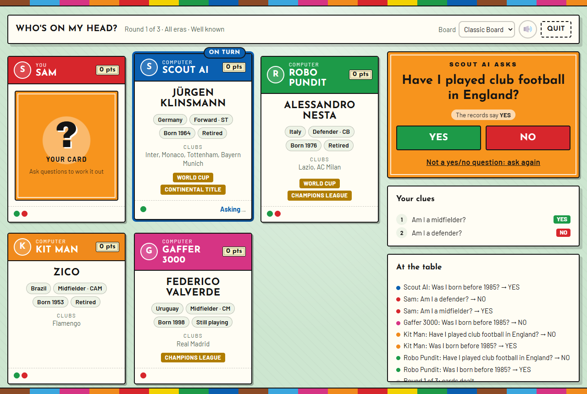
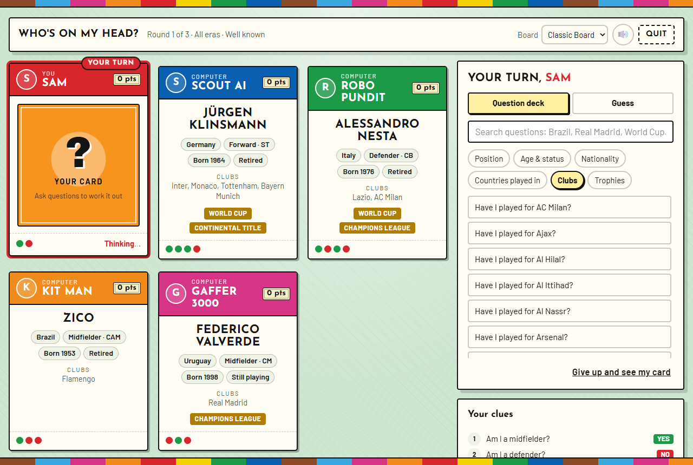
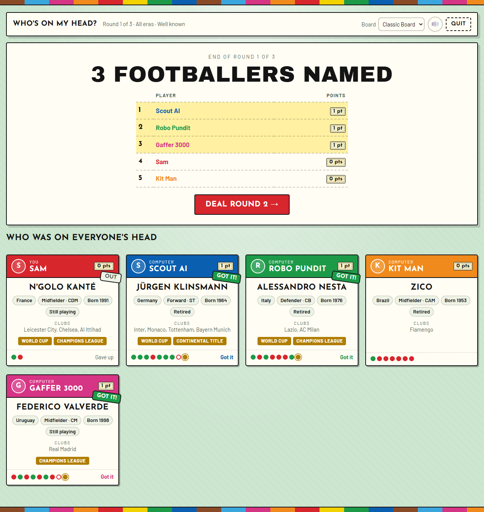
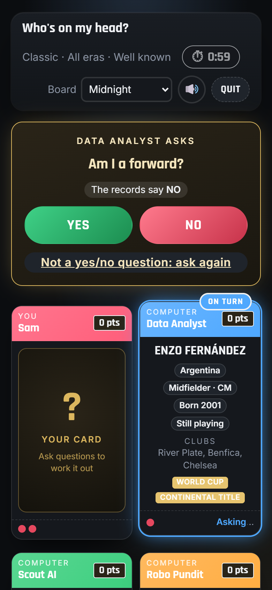
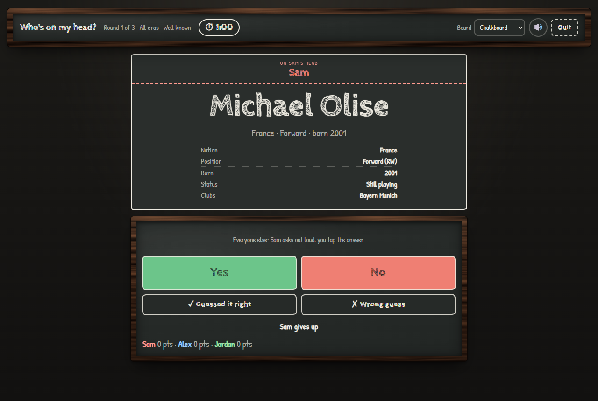
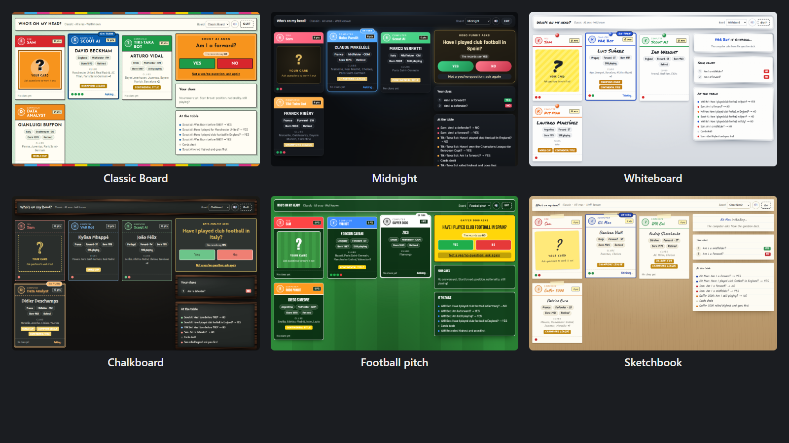
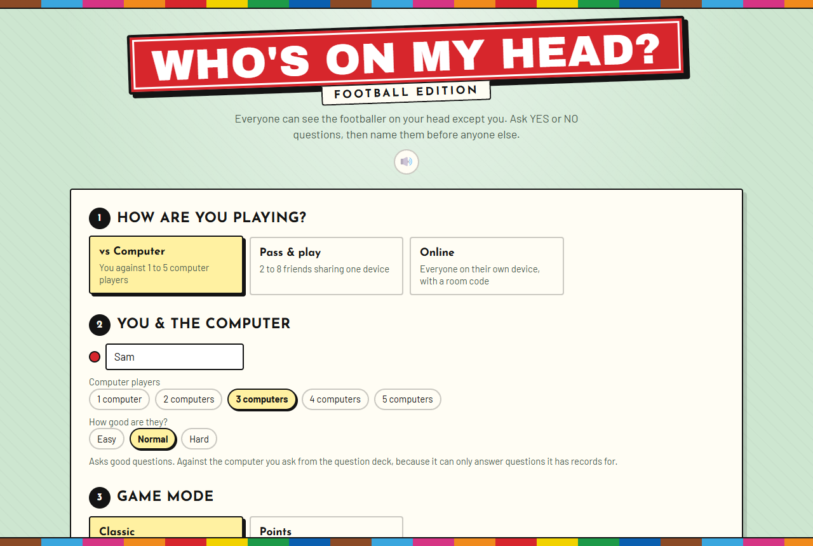

# Who's on My Head? Football Edition

> **Unofficial fan-made game.** Free to play, not sponsored, and not affiliated with FIFA, UEFA, Hasbro, or any club, league or player. See the [Disclaimer](#disclaimer).

**▶ Play now: [drag375o.github.io/Who_Is_On_My_Head_football_edition](https://drag375o.github.io/Who_Is_On_My_Head_football_edition/)**

A browser party game. Everyone gets a footballer on their head: you can see everyone's card except your own. Ask YES / NO questions, keep going while the answers are YES, and name your footballer before anyone else.

Built from the same template as [Auction XI](https://auction-xi.netlify.app): plain HTML, CSS and JavaScript, no build step. Open `index.html` and play.



## Features

- **Three ways to play:**
  - **vs Computer:** you against 1 to 5 computer players (Easy, Normal, Hard).
  - **Pass & play:** 2 to 8 friends sharing one phone or laptop. On your turn you hold it to your forehead and the others tap the answers.
  - **Online:** 2 to 8 players, each on their own device, joined by a 5-letter room code.
- **519 footballers**, from today's squads to the legends of every era, including all of Auction XI's players.
- **Club legends decks:** play with only Real Madrid, Barcelona, Manchester United, Liverpool, Bayern, Juventus, Milan, Inter or 16 other clubs (current squad, alumni and all-time greats).
- **Mixed decks** by era (2024 onward, 2010s, 2000s, Legends, All) and fame (Superstars, Well known, Everyone).
- **A question deck** of ready-made questions answered from the records (position, nationality, age, clubs, countries played in, Ballon d'Or, World Cup, Champions League…), plus your own typed or spoken questions.
- **Classic and Points modes**, an optional turn timer (30 / 60 / 90 s), and dice to decide who goes first.
- **Sound effects** for every moment (dice, cards, YES chime, NO buzzer, correct-guess fanfare, whistle, crowd), with a mute button.
- **Player cards** show each footballer's nation, position, age, clubs and trophies at a glance, with a trail of coloured dots for every YES and NO that player has had.
- **Six board styles:** Classic Board (default, Monopoly-inspired), Midnight, Whiteboard, Chalkboard, Football pitch and Sketchbook.
- **Works on phones, tablets and computers.** Nothing to install.

## Screenshots

**Your turn.** Pick a ready-made question from the deck (or search it), or type a guess. Your own card stays hidden.



**End of a round.** Everyone's card is revealed, with their trail of answers and who got it.



**On a phone** (Midnight style) the question comes first, then the players. **Pass & play** (Chalkboard style) shows the card big, for holding up to your forehead.

<p>
  
  &nbsp;
  
</p>

**The six board styles:**



**Setting up a game:**



## How to play

1. **Get a card.** Everyone gets a random footballer. No two players have the same one in a round.
2. **Roll for first turn.** Everyone rolls two dice; the highest total asks first. Turns then go round the table.
3. **Ask YES / NO questions.** "Am I Brazilian?" "Have I played for Real Madrid?" The others may only answer YES or NO, and must answer truthfully.
4. **YES: keep going.** A YES means you ask again. A NO ends your turn.
5. **Guess any time** during your turn. Right: you score. Wrong: your turn ends.
6. **Win.**
   - **Classic:** the first correct guess wins the game.
   - **Points:** each correct guess is 1 point. A round ends when only one player is still guessing. After 3, 5 or 7 rounds the most points wins (ties share the win).

### Details

- **Answers online:** everyone except the asker answers. The majority decides, and the game settles as soon as the result can't change. A tie goes to the earliest answer. The room creator can **go with the answers so far** if someone is slow.
- **Not a yes/no question?** Answerers can send it back: the asker asks again and the turn goes on.
- **Ready-made questions** show "The records say YES / NO" to the people answering, to help keep answers truthful.
- **Guessing:** spelling doesn't need to be perfect (small typos are forgiven), and nicknames work (CR7, R9, Kun Agüero, Gazza…). If a name fits several footballers ("Ronaldo", "Müller"), you're asked for the full name and your turn carries on. An exact full name always counts.
- **Give up:** see your card and sit out the rest of the round.
- **Turn timer:** when it runs out, your turn ends. Online and vs Computer it pauses while others answer. In pass & play it starts when you tap **I'm ready**.
- **vs Computer:** you ask from the question deck, because the computer can only answer questions it has records for. The computer answers truthfully. It works out who it is from its answers and from the cards it can see on everyone else's head.

## Playing online

1. Open the [game](https://drag375o.github.io/Who_Is_On_My_Head_football_edition/), choose **Online**, set the mode and deck and press **Create a room**.
2. Share the 5-letter code, or press **Copy invite link** and send that.
3. Friends open the link (the code is filled in for them), or open the game, choose **Online** and type the code. They type their name and press **Join room**.
4. When everyone is in, press **Start the game**.

- Each player's own card is hidden on their device and never sent to it until it's revealed.
- **Dropped connection:** the player's turns are skipped while they're away. Their device reconnects automatically for about 2 minutes; after closing the page, **Rejoin** puts them back in their seat. The room creator can **Remove** a player who isn't coming back.
- **Room creator reloads:** the game is saved in their browser for 12 hours. **Resume game** reopens the same room and everyone reconnects.
- Online play is peer-to-peer (WebRTC via [PeerJS](https://peerjs.com/)), matched through the free PeerJS server. No account or game server is needed. The room creator's browser runs the rules.

## Running and hosting

- **Locally:** open `index.html` in Chrome, Edge, Firefox or Safari.
- **Offline:** vs Computer and pass & play work offline (fonts fall back to system fonts). Online rooms need internet.
- **GitHub Pages:** Settings → Pages → Deploy from a branch → `main`, `/ (root)`. The site appears at `https://<user>.github.io/<repo>/` a minute later and updates on every push.
- **Netlify:** drag this folder onto *Sites → Add new site → Deploy manually*, or run `npx netlify-cli deploy --prod --dir .` once the folder is linked.

Online players must all use the same web address to find each other's rooms.

## Project structure

```
index.html                  page shell, fonts, PeerJS, theme stylesheets
css/base.css                layout and components shared by every theme
css/themes/*.css            board (default), midnight, whiteboard, chalkboard, pitch, sketchbook
js/data/clubs.js            nations, continents, countries and the clubs questions can ask about
js/data/footballers-core.js footballers from the Auction XI database
js/data/footballers-clubs.js club squads (2025–26), alumni and legends
js/cards.js                 builds the cards, picks decks (era, fame, club)
js/questions.js             the question deck and the guess checker
js/engine.js                game rules and state (no DOM)
js/ai.js                    the computer player
js/sound.js                 sound effects (Web Audio, no files)
js/net.js                   online rooms (PeerJS)
js/ui.js                    screens, clicks, online lobby, syncing, saving and rejoining
tests/                      data checks, engine simulation, browser playthroughs
docs/screenshots/           the pictures in this README (tests/readme_shots.py retakes them)
last_Update.md              what the game does now and its version history
```

## Testing

```
node tests/check-data.js        # database: duplicates, unknown codes, deck sizes
node tests/check-questions.js   # every question answers every card; guess checker cases
node tests/simulate.js          # 240 computer-only games through the engine
python tests/ui_play.py         # Chrome: vs Computer, pass & play, phone width
python tests/ui_play.py online  # Chrome: 3-device online game via PeerJS (needs internet)
python tests/readme_shots.py     # Chrome: retake the README pictures in docs/screenshots/
```

The browser tests need Python with Playwright and Google Chrome.

## Customising

- **Footballers:** add rows to `js/data/footballers-*.js`. The row format is documented at the top of `footballers-core.js`. Every club in `WOH.CLUBS` that the player played for must be listed. Then run `node tests/check-data.js`.
- **Clubs the questions can ask about:** `WOH.CLUBS` in `js/data/clubs.js`. Adding a club means checking every footballer who played for it.
- **Questions:** `describe()` and `answer()` in `js/questions.js`.
- **Rules:** `js/engine.js` (`MAX_PLAYERS`, modes, voting). Rules text is `RULES` at the top of `js/ui.js`.
- **Themes:** copy a file in `css/themes/`, change the selector to `[data-theme="yourtheme"]`, link it in `index.html` and add it to `THEMES` in `js/ui.js`.
- **Sounds:** `SOUNDS` in `js/sound.js`.

## Disclaimer

Who's on My Head? Football Edition is an **unofficial, fan-made browser game**, made for fun and free to play.

- It is **not affiliated with, endorsed by, sponsored by or connected to** FIFA, UEFA, any football club, league, national association or players' union, or any player or coach named in the game.
- The Classic Board style is inspired by classic property-trading board games. It is **not affiliated with Hasbro or Monopoly** and uses no Monopoly artwork, logos or text.
- The project owner **does not own any rights** to the names of the players or clubs. All names belong to their respective owners and are used only to identify them.
- **Footballer facts** (clubs, honours, birth years, whether they're still playing) were written from general knowledge, checked up to mid-2026, and may contain mistakes. Honours are recorded up to the 2024–25 season and the 2025 Ballon d'Or, so the 2026 World Cup and 2025–26 trophies aren't included.
- No logos, crests, kits or photographs are used. There are no ads, payments or in-game purchases.
- If you are a rights holder and would like anything changed or removed, please contact the project owner.
